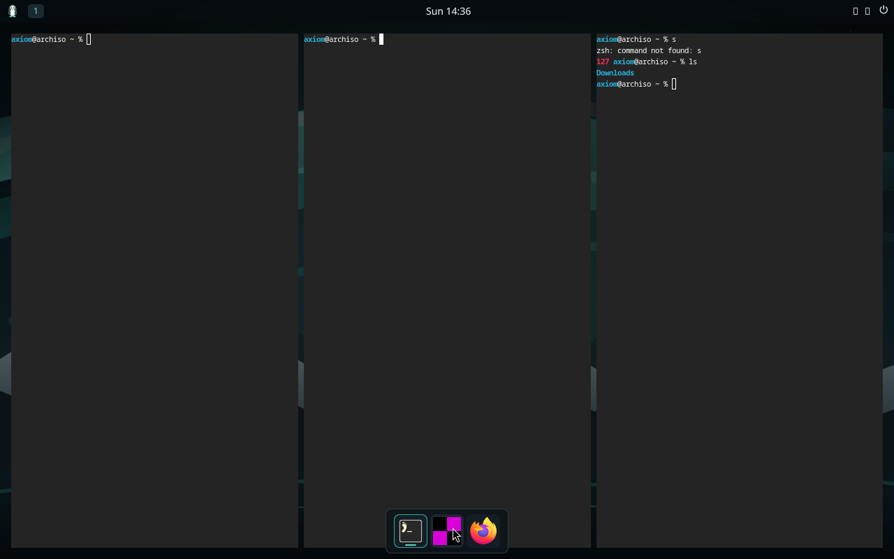

<p align="center">
  
</p>

<p align="center">
  <b>An open-source Linux desktop for developers, built for safe AI automation, privacy and recovery.</b>
</p>

<p align="center">
  <a href="LICENSE"></a>
  
  
  <a href="CONTRIBUTING.md"></a>
</p>

---

Axiom is a Linux desktop for developers, built from first principles. It keeps
the parts of Linux that already work well (the kernel, systemd, drivers,
PipeWire, Mesa, Wayland, pacman) and builds its own versions of the parts you
see and use: the shell, core apps, installer, login, system services and,
later, a permission-bounded AI layer.

The main idea is that **AI should be able to help you run your machine without
ever holding root.** An agent can propose actions. Narrow, audited system
services decide whether those actions run. The desktop still works fully with
no AI and no network.

> **Status: pre-alpha.** Phases 0 to 6 of 13 are complete and verified in QEMU:
> Axiom installs to a blank disk, reboots, logs in and keeps your settings. The
> security layer (Phase 11) and AI layer (Phase 12) are designed but **not built
> yet**. Don't use Axiom on a machine whose data you care about.

<p align="center">
  
  <br><sub>The Axiom Shell running in QEMU during Phase 3 bring-up.</sub>
</p>

## What works today

Every item below is tested in a real QEMU boot by automated tests that send key
and pointer input and then check the result on disk or in system state.
Screenshots are kept as evidence, but they never decide whether a test passes.

| Area | What you get |
| --- | --- |
| **Shell** | Top panel, dock, launcher with search, workspaces, tray, notifications, control center, session menu, lock screen |
| **Core apps** | Files (copy, move, trash and restore, hostile file names), Settings, Terminal, a read-only Software Center |
| **System** | Wi-Fi, audio, display scaling with automatic revert, power profiles, idle screen-off, all through the real Linux services |
| **Install** | Terminal installer with optional LUKS disk encryption, greetd login screen, no autologin, a locked root account |
| **First boot** | Developer Hub: a curated set of developer tools that installs on first boot and is safe to re-run |

Test totals and their limits are recorded in [PHASES](docs/PHASES.md).

## Roadmap

| Phase | Goal | State |
| --- | --- | --- |
| 0-2 | Architecture reset, bootable base, Wayland session | Done |
| 3-4 | Axiom Shell and core apps | Done |
| 5 | System experience (network, audio, display, power) | Done |
| 6 | Installable system | Done |
| 7 | Package management, updates and rollback | Next |
| 8-10 | Daily-driver completeness, developer edition, real hardware | Planned |
| 11 | Security layer: capability permissions, scopes, audit | Planned |
| 12 | AI-native layer: optional agent and safe automation | Planned |
| 13 | Signed updates and releases | Planned |

The phase gates, with exit criteria, are in [PHASES](docs/PHASES.md) and the
longer view is in [ROADMAP](docs/ROADMAP.md).

## Design principles

- **AI never gets root.** No unrestricted sudo and no arbitrary shell
  passthrough. Each privileged API checks the caller, the operation and the
  target separately, and denies by default.
- **Works offline, works without AI.** Boot, login, windows, files and the
  terminal never depend on a model or a cloud service.
- **Reuse mature Linux.** Axiom doesn't rewrite the kernel, init, drivers or
  package manager. It owns the experience on top of them.
- **Evidence over claims.** A milestone counts as done only when the real
  image boots in disposable QEMU with serial, journal and display evidence
  kept. Performance claims need measurements.
- **Wayland and portal boundaries stay intact.** Automation never weakens the
  consent prompts the user sees.

The full contract is in [ARCHITECTURE](docs/ARCHITECTURE.md) and
[SECURITY](docs/SECURITY.md).

## Try it

You need an **Arch Linux** (or Arch-based) host with KVM. Building runs
unprivileged through user namespaces.

```sh
sudo pacman -S --needed archiso qemu-desktop edk2-ovmf tigervnc python

git clone https://github.com/Prof-bilal/Axiom.git
cd Axiom

# Build the ISO (about 30 minutes; output goes to iso/out-phase3/)
scripts/build-phase3-iso.sh

# Boot it in a disposable VM, viewed over VNC on 127.0.0.1:5901
scripts/run-vm.sh iso/out-phase3/axiom-*.iso
```

To try the installer, add `axiom.installer=1` to the kernel command line, or
let `tests/phase6-install.py` drive a full install onto a blank virtual disk.
See [BUILD](docs/BUILD.md) and [the installer notes](docs/engineering/INSTALLER.md).

## Run the checks

```sh
python3 scripts/validate-repo.py                      # docs, links, skills, profile
python3 scripts/test-concepts.py                      # concept checks
python3 -m unittest discover -s tests/installer -v    # installer backend, no root or VM
node --test tests/apps/*.test.mjs                     # core app logic
```

The QEMU acceptance suites (`tests/phase3-desktop.py`, `tests/phase4-apps.py`,
`tests/phase5-system.py`, `tests/phase6-install.py`) are described in
[TESTING](docs/TESTING.md).

## Repository map

| Path | Contents |
| --- | --- |
| `shell/` | Axiom Shell (Quickshell/QML): panel, dock, launcher, lock screen |
| `apps/` | Core apps: Files, Settings, Software Center |
| `installer/`, `greeter/`, `provision/`, `tui/` | Installer, login screen, first-boot job, shared terminal UI |
| `catalog/` | Developer Hub tool catalog |
| `iso/` | archiso profiles for the live and installable image |
| `tests/` | Unit tests and QEMU acceptance suites |
| `scripts/` | Build, VM and repository validation helpers |
| `docs/` | Product, architecture, decisions (ADRs), phases and evidence |
| `branding/` | Axiom identity: wordmark, penguin, palette, wallpapers |

## Documentation

| Area | Start here |
| --- | --- |
| Product and design | [PRODUCT](docs/PRODUCT.md), [VISION](docs/VISION.md), [DESIGN](docs/DESIGN.md) |
| Architecture and decisions | [ARCHITECTURE](docs/ARCHITECTURE.md), [DECISIONS](docs/DECISIONS.md), [ADRs](docs/decisions/), [reset report](docs/engineering/ARCHITECTURE_RESET_IMPACT.md) |
| Scope | [PHASES](docs/PHASES.md), [ROADMAP](docs/ROADMAP.md), [MVP](docs/MVP.md) |
| Building and testing | [DEVELOPMENT](docs/DEVELOPMENT.md), [BUILD](docs/BUILD.md), [TESTING](docs/TESTING.md) |
| Desktop contracts | [desktop UX](docs/desktop/DESKTOP_UX.md), [design tokens](docs/desktop/DESIGN_SYSTEM.md), [Wayland](docs/desktop/WAYLAND.md) |
| AI and security | [AI architecture](docs/ai/AI_ARCHITECTURE.md), [security contract](docs/SECURITY.md), [threat model](docs/security/THREAT_MODEL.md) |

## Contributing

Axiom is a young project and there's a lot to pick up: QML shell work, Python
system tooling, QEMU testing, design, docs and translations. Start with
[CONTRIBUTING](CONTRIBUTING.md), and look for issues labelled
`good first issue`. Everyone taking part follows the
[Code of Conduct](CODE_OF_CONDUCT.md).

Found a security problem? Please report it privately as described in
[SECURITY.md](SECURITY.md), not in a public issue.

## License

Axiom's source code is released under the [Apache License 2.0](LICENSE).
The scripts under `iso/` that come from archiso keep their original
GPL-3.0-or-later license, marked in each file's SPDX header. The Axiom name,
logo and penguin mascot are not covered by either license. See
[TRADEMARKS](TRADEMARKS.md).
Third-party components keep their own licenses, listed in
[THIRD_PARTY_NOTICES](THIRD_PARTY_NOTICES.md).
