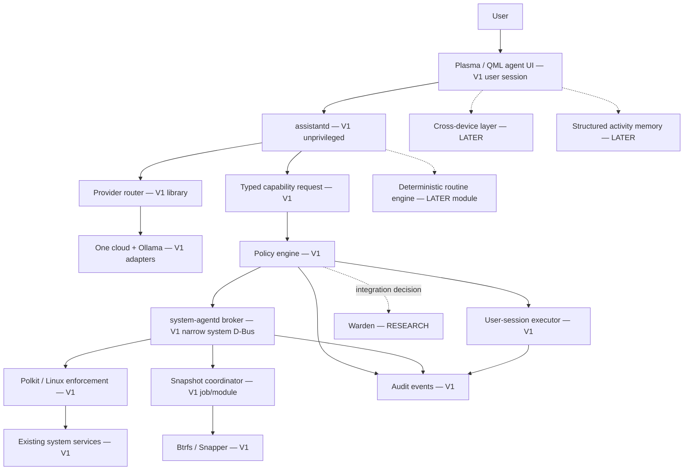

# Architecture

Status: design baseline, not implemented. V1 is a prototype scope label; LATER is intentionally deferred; RESEARCH means no dependency may assume support. See [ADRs](DECISIONS.md), [API contract](ai/SYSTEM_AGENT_API.md) and [security](security/SECURITY.md).

## Processes and privilege boundaries

Plasma/KWin provides the compositor and existing desktop integration. Shell customizations and QML apps run as the logged-in user. Never move UI into a root process to bypass permissions. The overlay is a client, not the policy authority.

`assistantd` is a proposed per-user process for cancellation, request lifecycle and adapter IO. It has no system privilege; justify its idle cost before making it persistent. Router, planner and routine engine are modules, not separate daemons. Models return proposals; a non-model validator produces bounded typed requests. No plan itself conveys authority.

`system-agentd` is a proposed minimal system broker, preferably activatable, for operations existing services cannot safely expose directly to the caller. Split user actions from privileged handlers; do not make every capability transit a root executor. Every privileged handler authenticates D-Bus sender identity, validates target and authorizes independently of the assistant's claims. Reuse existing service APIs/Polkit when they already provide the required scope. Determine per-handler process isolation in a threat review, rather than requiring the entire broker to be root permanently.

The policy engine performs deterministic classification and request-bound authorization. A trusted confirmation UI shows canonical target, side effects and recovery limitations, separate from model-authored text. Warden remains an evaluated enforcement adapter only: identify repository, revision, Linux behavior and gaps before integration. Linux mechanisms supply defense in depth, not a competing orchestration architecture.

## IPC and contracts

Session D-Bus connects user UI and session services. System D-Bus carries the narrow privileged API and upstream service calls. Version interface names and explicit error/result schemas; prohibit arbitrary bus destination/method forwarding. Proposed names are design identifiers pending a project-controlled reverse-DNS namespace. Do not ship fabricated `org.axiom` ownership assumptions.

Unix sockets require a demonstrated need (for example bounded local streaming); document filesystem permissions, peer credentials, framing, limits, cancellation and authorization parity. Do not introduce general RPC infrastructure by default. Model streaming stays in the session process and cannot bypass the capability contract.

## State and audit

Use per-user SQLite for application metadata; FTS5 only for user-visible search requirements. System audit persistence belongs to the privileged boundary with append-only behavior from unprivileged callers. An audit database is not tamper-proof against root. Each action has correlation ID, actor/session, normalized request digest, policy/version, authorization scope/expiry, timestamps, affected resources, execution status, verification and recovery reference. Redact secrets/content and bound retention; record pre-execution intent before mutation and report crash reconciliation states. Audit history remains distinct from future opt-in personal activity memory.

Package/config changes use serialized jobs with preflight, authorization, eligible snapshots, execution, verification and explicit commit/recovery. No claim of atomic rollback across Btrfs, ESP, pacman hooks, firmware, cloud or another device. [Recovery](system/BTRFS_ROLLBACK.md) owns layout and consistency requirements. Audit evidence must survive recovery or explicitly expose a recovery gap.

## Future components and directory boundaries

| Path / component | Status | Responsibility |
| --- | --- | --- |
| `apps/{control-center,launcher,settings,welcome,agent-ui}` | V1 incrementally | Session UI; shared design tokens |
| `shell/{panel,dock,notifications,workspace}` | V1 incrementally | Plasma extensions; KWin remains compositor |
| `services/{assistantd,system-agentd}` | V1 | Session orchestration and narrow privileged execution |
| `services/performanced` | RESEARCH | Only if existing resource tools fail requirements |
| `services/{connectd,memoryd}` | LATER, process need unproven | Device / activity modules first |
| `security/{policies,warden}` | V1 policies / RESEARCH Warden | Reviewed enforcement configuration |
| `packages`, `iso`, `installer`, `branding`, `tests` | V1 as phases authorize | Packaging, image, installation, identity and evidence |
| Workspace continuation | LATER | Serializable intent, not process/checkpoint migration |

These paths are intended architecture, not empty directories to create now. Dependency direction is UI → session runtime → typed contract → authorized executor → upstream service. No provider-specific type in the capability or policy layer. Desktop and system operations remain usable without AI or network.

## Experiments before commitment

Prove UEFI boot + Btrfs recovery including ESP mismatch; Plasma extension packaging/upgrade; per-user/system bus authorization and sender races; request-bound interactive approval; cloud/local adapter conformance; audit crash/recovery; sandbox ABI behavior; and clean-run reproducibility. See [research register](RESEARCH.md). Phase 6 mutation stays disabled until Phase 7 security gates pass, even though API implementation starts earlier.
