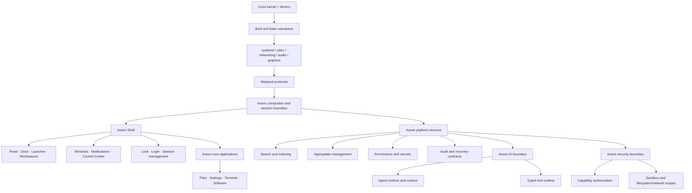

# Axiom architecture

Status: **Phase 3 shell MVP**. This is the active product boundary. The
previous upstream-derived desktop direction has been removed; it is not a
runtime or build dependency.

## Product boundary

Axiom reuses mature Linux infrastructure where it has no product value to
rebuild. Axiom owns the visible desktop, session behavior, developer workflow,
platform contracts, security UX and future applications.



## Layer ownership

| Layer | Upstream provides | Axiom owns | Status |
| --- | --- | --- | --- |
| Base system | Kernel, drivers, libc, systemd, udev, bootloader, package manager | Supported input set, image policy, recovery contract and provenance | Phase 1/RESEARCH |
| Device/network/audio/graphics | NetworkManager (or justified alternative), BlueZ, PipeWire/WirePlumber, Mesa, firmware and portals | Integration defaults, diagnostics and user-facing policy | Phase 1/5 |
| Display platform | Wayland protocols and compatible client libraries | Compositor/session API, window policy, input routing, outputs and workspace semantics | Phase 2 |
| Axiom Shell | Qt/QML or another reviewed UI toolkit | Panel, dock, launcher, workspace UI, window decorations, notifications, Control Center, lock/login/session UX | Phase 3 |
| Core apps | Toolkit and standard Linux APIs | Files, Settings, Terminal integration, Software Center and their information architecture | Phase 4 |
| Platform services | systemd/D-Bus/SQLite primitives | Search/indexing, app/update contracts, permissions, secrets, audit and recovery orchestration | Phase 5 |
| AI platform | Replaceable local/cloud providers and model libraries | Agent lifecycle, context, typed tools, consent and offline degradation | Phase 7 |
| Security platform | Kernel namespaces, Landlock/seccomp where proven, Polkit, portals and systemd sandboxing | Capability policy, Warden adapter boundary, scopes, audit and fail-closed behavior | Phase 6 |

The UI never runs as root. Privileged operations use narrow versioned D-Bus
interfaces or existing authorized services. Models and tools propose typed
requests; they do not convey authority. Core desktop operation does not depend
on network access or AI availability.

## Display and compositor strategy

Three approaches were evaluated during the reset:

| Option | Benefit | Cost/risk | Decision |
| --- | --- | --- | --- |
| A. Build an Axiom compositor on wlroots or a comparable low-level library | Maximum window/input policy ownership and a clean long-term product boundary | Security-critical Wayland code, accessibility, multi-GPU/output behavior, protocol compatibility and a large test matrix | **Long-term candidate; Phase 2 research only** |
| B. Use a small existing compositor as the permanent foundation | Fastest path to a usable desktop and hardware coverage | Repeats the old lock-in problem; product behavior and release cadence remain upstream-owned | **Rejected as the product architecture** |
| C. Build the Axiom shell/session contract first with a temporary compositor harness, then assume compositor ownership | Validates real shell workflows early while keeping the product boundary explicit; avoids a fake browser UI | Requires a temporary compatibility adapter and later migration work; compositor ownership must not be postponed indefinitely | **Selected** |

The Phase 1/2 implementation target is a minimal existing Wayland compositor
only as a disposable bring-up harness (candidate packages are RESEARCH and are
not named as an Axiom dependency). The harness must expose standard Wayland
protocols and a narrow adapter for launch, outputs, input and workspaces. It may
not define Axiom UX, identity, permissions or release claims. Phase 2 chooses
the Axiom compositor implementation after measuring the harness and validating
the session contracts; a wlroots-based or Rust compositor library remains an
engineering choice, not a product dependency decision.

## Session contracts

The compositor/session boundary owns:

- output discovery, scale and transform;
- seat and input routing with Wayland consent boundaries;
- application launch and lifecycle observation;
- window placement, focus and workspace state;
- lock-screen exclusion and session shutdown/restart;
- a versioned event/query interface consumed by the shell.

The shell owns presentation and interaction, not privileged execution. A shell
surface must be reconstructible from real session/service state after restart;
no hardcoded fake windows, app icons, timers or notification counts satisfy an
acceptance gate.

## Dependency rules

1. Prefer a standard Linux primitive, library or protocol over a new daemon.
2. Keep upstream components behind replaceable adapters; no upstream desktop
   project is the Axiom product contract.
3. Keep ownership and license provenance recorded before a package is shipped.
4. Keep user-session UI and AI unprivileged; independently authorize target,
   operation and caller for every privileged request.
5. Keep storage local by default: SQLite/FTS5 for user metadata, system audit at
   the privileged boundary, and no server database without measured need.
6. Keep the desktop useful offline and without model providers.
7. Treat QEMU as the reproducible gate until hardware evidence exists.

## Future repository boundaries

Create implementation directories only when their phase authorizes real work:

```text
system/       base image, boot, device and package contracts
compositor/   Axiom compositor/session implementation
shell/        Axiom Shell surfaces and design-token runtime
apps/         Files, Settings, Terminal and Software
services/     search, app/update, audit and session services
security/     capabilities, sandbox adapters and policy
ai/           agent/context/provider adapters
packages/     PKGBUILDs and package manifests
vm/           reproducible QEMU fixtures and evidence
assets/       reviewed product assets
docs/         contracts, research and evidence
```

These names are boundaries, not empty scaffolds. Phase 0 creates contracts and
tests; Phase 1 creates only the minimal base needed to boot a real graphical
session.

## Phase 3 shell implementation

- **Shell:** `shell/` — panel, dock, launcher, workspaces, notifications,
  status and session surfaces as QML components, consuming only the service
  singletons in `shell/services/`.
- **Toolkit:** Quickshell/QML 0.3.2, a replaceable implementation dependency
  (LGPL-3.0-only), not Axiom identity.
- **Compositor:** a *temporary* harness (sway, MIT) providing standard protocols
  (`zwlr_layer_shell_v1`, `zwlr_foreign_toplevel_management_v1`,
  `ext-workspace-v1`). `WorkspaceService` and `WindowService` are the only
  adapters that name a compositor protocol; an Axiom compositor replaces them.
- **Session:** `iso/phase3/airootfs/usr/local/bin/axiom-session` and
  `axiom-shell`, unprivileged user `axiom`, autologin on tty1.
- **Decision and rationale:** [ADR-015](decisions/phase3-shell-architecture.md).
