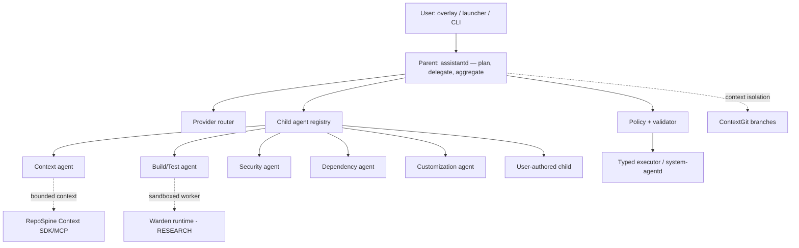

# Agent system: one parent, many bounded children

Status: V1 design / RESEARCH — no runtime exists. Nothing here authorizes a new daemon or a
new privilege; it defines how the *existing* contracts ([AI architecture](AI_ARCHITECTURE.md),
[System Agent API](SYSTEM_AGENT_API.md), [permissions](../security/PERMISSIONS.md)) are
composed for many agents instead of one. Last researched: 2026-10-25.

The product goal is one parent AI system that developers talk to, which spawns specialised
child agents instead of one giant prompt. This document defines the shape, the built-in
catalogue and how users add their own.

## Principles

1. **One parent, one authority.** A single orchestrator (the *parent*, working name
   `assistantd`) owns planning, provider selection and delegation. Child agents are workers
   it spawns, not peers it negotiates with. There is no second orchestrator and no new
   daemon per agent — router, policy and registry stay modules.
2. **Children are bounded and ephemeral.** Every child has a declared capability allowlist,
   a context scope, a resource/time/step budget and an audit identity. A child that runs out
   of budget stops; it does not silently re-plan.
3. **Authority never grows downward or upward.** The parent cannot grant a child more than
   the parent holds, and a child cannot self-authorize. A child's proposal re-enters the
   parent → policy → executor path; the model never approves its own action.
4. **Model output is never authority.** Child output is a *proposal*; only the deterministic
   validator + policy engine produce a typed request ([permissions](../security/PERMISSIONS.md)).
5. **Least privilege by default.** A child gets the narrowest tool surface that satisfies its
   purpose (read-only repo context, or a sandboxed command worker), never the user's whole
   environment.
6. **Every child is attributable.** Audit records actor = child identity, parent request id,
   context scope, capability versions, outcome, verification and recovery coverage.
7. **Degrade, don't escalate.** No provider → deterministic capabilities and local-only
   agents still work. Missing sandbox → the child fails closed rather than running unsandboxed.

## Shape

Children do not talk to each other directly in V1. Coordination is the parent's job through
a shared, versioned task graph — this keeps accountability linear and avoids the
agent-to-agent trust problem. Peer handoff is deferred (see *Failure modes*). The UI is Axiom Shell on Hyprland/Quickshell (ADR-013); the runtime has no Plasma/KWin dependency.

## Child agent contract (proposed)

A language-neutral declaration; no method or file format is implemented yet. A concrete
schema and D-Bus/registry mapping must be authored before any child is enabled.

| Field | Meaning |
| --- | --- |
| `id`, `version` | Stable identity + capability version for validation and audit |
| `purpose` | One-line, non-overlapping scope (drives registry collision checks) |
| `capabilities[]` | Subset of [System Agent API](SYSTEM_AGENT_API.md) capabilities; minimum class from permissions |
| `tools[]` | Allowed tool surfaces (repo context, bounded file read, sandboxed exec). Dynamic/model-supplied tool names are rejected |
| `model_binding` | Provider/model or local-only; never a secret; cloud use requires consent |
| `context_scope` | Bounded context package (RepoSpine) + isolated context branch (ContextGit) |
| `sandbox` | `none` (pure read/reason) or required sandbox profile (Warden) |
| `budget` | max steps, wall time, tokens/cost, concurrency |
| `evidence` | What the child must return to be trusted (files touched, commands, verification result) |
| `failure_policy` | Stop / compensate / escalate-to-parent. Never "retry a mutation" |

## Built-in child catalogue (PROPOSED — not implemented)

A dozen, not a hundred. Each maps to an owner role in [SUBAGENTS](../SUBAGENTS.md) and a
capability subset; counts and names are a proposal for review.

| # | Child | Purpose | Default class | Sandbox |
| --- | --- | --- | --- | --- |
| 1 | **Context** | Assemble bounded repo context for a task (RepoSpine) | OBSERVE | none |
| 2 | **Research** | Web/doc research with citations; no OS action | OBSERVE | none |
| 3 | **Build** | Run the project's build; report errors | NORMAL | required |
| 4 | **Test** | Run tests; summarise failures; no source edits without parent plan | NORMAL | required |
| 5 | **Debug** | Reproduce + localise a failure; propose a fix plan | NORMAL | required |
| 6 | **Security** | Adversarial review of a proposed change | OBSERVE | none |
| 7 | **Dependency** | Inspect/upgrade dependencies; produces a reviewed plan | SENSITIVE | required |
| 8 | **Environment** | Detect/select toolchains + services (see [dev environments](../engineering/DEV_ENVIRONMENTS.md)) | SENSITIVE | required |
| 9 | **Data/Service** | Start/stop enrolled local services (DB/cache) | SENSITIVE | container |
| 10 | **Performance** | Observe resource pressure; propose Flow presets (no kill) | OBSERVE→NORMAL | none |
| 11 | **Customization** | Preview/apply reversible desktop customization (Morphix) | NORMAL | none |
| 12 | **Model Eval** | Benchmark a candidate model before it becomes a default (ModelCheck) | OBSERVE | required |

Additional specialist children (docs/changelog, migration, routine author) are additive and
must justify non-overlap with the twelve above.

## User-authored child agents

Users must be able to define their own child — that is a core product promise, not an
extension. Constraints:

- **Declarative only.** A definition is metadata + a prompt (Skill-style frontmatter, like
  the project's `.agents/skills/*/SKILL.md`), not executable code. No scripts, no shell, no
  absolute paths, no embedded secrets. A child may *request* capabilities; it never declares
  its own authority.
- **Inherited ceiling.** A user child can only use capabilities the user already holds and
  that the parent exposes. Approval is per-capability and can be revoked.
- **Validated + registered.** Schema validation, purpose-collision check against built-ins,
  and an explicit review step before the child becomes selectable. Imported/shared children
  are untrusted input (same rule as imported [routines](ROUTINES.md)).
- **Traceable.** Editing a child definition invalidates its grants and requires re-approval.
- **No new privilege paths.** A user child uses the same Policy → executor → audit path; it
  cannot invent a capability, a bus destination or a root action.

## Failure modes and mitigations (from this round's research)

Multi-agent designs fail in known ways; these are recorded so the architecture answers them:

| Failure | Mitigation here |
| --- | --- |
| Error compounding across hops | Children return structured evidence, not prose; the parent verifies before chaining |
| Context bloat / cost blow-up | Bounded `context_scope` + hard token/step/cost budget per child |
| Runaway loops / recursion | Max-depth + max-children; no child-to-child spawning in V1 |
| Unclear accountability | Linear parent→child attribution; every step attributed |
| Agent-to-agent trust | No peer channels in V1; shared task graph is parent-owned |
| Silent partial success | Failure policy distinguishes partial/uncertain from no-action and surfaces it |

## Not authorized

No arbitrary shell, no root, no autonomous CRITICAL actions, no silent background mutation,
no generic bus forwarding, no new daemon per agent. Critical actions always re-confirm with
the user ([permissions](../security/PERMISSIONS.md)).

## Where this lands

| Piece | Phase |
| --- | --- |
| Parent orchestrator, router, registry skeleton | 4–5 |
| Read-only child set (context, research, security, performance) | 6 |
| Sandboxed child workers (Warden) | 7 |
| Reversible state children (dependency, customization) | 8 |
| User-authored children | after 7 (needs the full grant model) |
| Deterministic routine graph | 12 |

Sources for the research round (assistant failure modes and orchestration patterns) are
recorded in [RESEARCH](../RESEARCH.md); [ecosystem](ECOSYSTEM.md) maps the first-party products
this design leans on.
