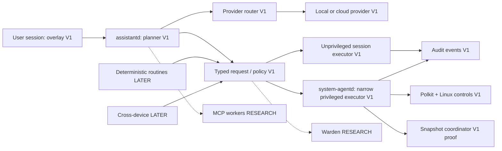

# AI architecture

Status: V1 design, no runtime exists. Phase 6 mutation handlers stay disabled until Phase 7 authorization/audit gates pass. Last verified: 2026-10-18.

Planning and execution are separate. Model responses are proposals, never authorization. assistantd and overlay run as the user; no provider is reachable from the privileged executor. A policy module validates capability/schema versions, originating identity, resource scope and consent. system-agentd repeats checks against transport-authenticated identity and consumes exact one-use grants. Do not expose a root shell, generic command, arbitrary D-Bus call or unrestricted file API. Reuse existing desktop/system services rather than duplicating their authority. The session UI is the Axiom-owned shell/session client; it has no dependency on another desktop project.

## Request lifecycle

Resolve intent to a bounded plan → validate and estimate effects → authorize bounded snapshot preparation if supported → prepare snapshot → obtain approval for exact mutation plan → journal intent durably → execute fixed typed adapter → verify → record outcome and rollback coverage → display result. No privileged snapshot write occurs before authorization. Snapshot failure blocks operations that promised recovery. A failed verification may trigger a separately reviewed bounded recovery procedure; never conceal partial failure. See [API](SYSTEM_AGENT_API.md), [permissions](../security/PERMISSIONS.md), and [rollback](../system/BTRFS_ROLLBACK.md).

## Process and event discipline

Start with assistantd and system-agentd only where necessary; router, policy, routine and audit are logical modules, not requirements for separate daemons. Use session D-Bus for local UI/runtime integration and system D-Bus only for narrow privileged operations. Provisional bus names require naming/version review before implementation. Long actions return request/job IDs, bounded progress, cancellation status and final verification. Cancellation is best effort: package database operations cannot be arbitrarily killed.

Local SQLite stores redacted searchable user activity with FTS5; a separate protected executor journal records privileged mutations. Events correlate actor, request, capability, policy, authorization, resource changes, network summary and recovery. Do not equate log retention with unlimited activity surveillance. Structured local memory is LATER; continuous screenshots are excluded by default.

## Offline and degraded behavior

Desktop, package administration and recovery continue without model access. Deny unavailable model-only reasoning cleanly; deterministic capabilities and saved routines do not require a provider. Bound context, tool steps, wall time, concurrent jobs and provider cost. A model crash never causes implicit retry of an uncertain mutation. Test restart reconciliation and disconnected providers before host actions.

## Parent and child agents

The single orchestrator described above is the *parent*; the specialised workers it spawns are
*child* agents. The child catalogue, the declarative child contract, user-authored children
and the multi-agent failure modes are defined in [agent system](AGENT_SYSTEM.md); the
first-party products consumed behind adapters are mapped in [ecosystem](ECOSYSTEM.md). This
adds no daemon and no second orchestrator: children re-enter the same policy → executor → audit
path, and none of them authorizes an action.

Sources: [D-Bus](https://dbus.freedesktop.org/doc/dbus-specification.html), [MCP](https://modelcontextprotocol.io/specification/2026-07-28), [Polkit](https://polkit.pages.freedesktop.org/polkit/polkit.8.html).
