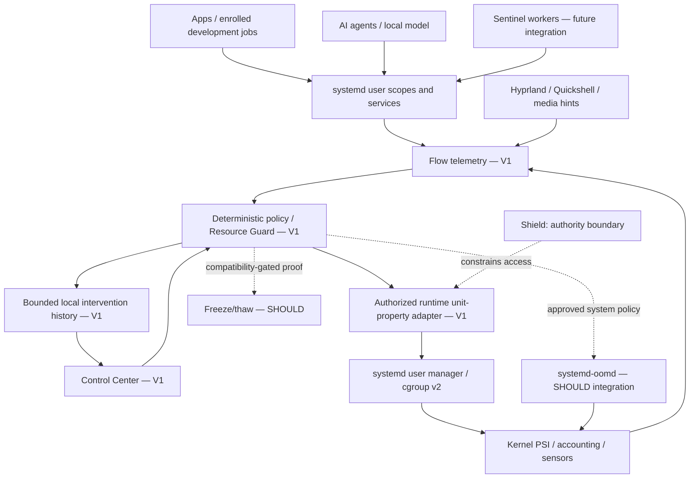

# Axiom Flow

Status: **design / Phase 0**, not implemented. Upstream research inspected 2026-10-18; all measurements **NOT YET MEASURED**. V1 below means the proposed small prototype, not production defaults. [Performance policy](PERFORMANCE.md) owns shared profiles/targets; [benchmarks](../engineering/BENCHMARKS.md) owns measurement methodology; [research](../RESEARCH.md) owns experiments and comparisons. This is the only canonical detailed Flow design.

## Purpose and boundaries

Flow owns resource orchestration and foreground responsiveness. A healthy desktop may use most RAM: judge stalls, latency, contention, workload progress and energy, rather than maximizing free memory. Protect useful work when browser, IDE, chat, containers, databases, compilers and AI agents compete.

| Platform subsystem | Responsibility | Flow boundary |
| --- | --- | --- |
| Desktop | Interaction, compositor, application launch and Control Center | Supplies minimal focus/activity signals; retains emergency controls |
| AI Runtime | Agent planning and typed execution | Can explain facts or propose settings; never controls the resource loop |
| Shield | Protect machine/user and enforce authority | Determines what workloads may do; Flow cannot broaden permissions |
| Sentinel | Test applications developers build | Workers declare resource budgets; Flow does not alter test semantics silently |
| Flow | Allocate resource budgets and preserve responsiveness | Uses kernel/systemd primitives; does not replace scheduling, security or testing |

Repository discovery found no dedicated Shield or Sentinel documents in this checkout. Their rows are conceptual integration contracts from the product requirement, not claims of implemented services/APIs. Do not create their internals here. These remain separate subsystems; sharing minimal telemetry never requires a combined daemon.

## Architecture and service decision



The first proof needs an on-demand collector and manual controller, not a new permanent service. Evaluate **one per-user Rust `flowd`** only when event subscriptions, fast policy reversal or recovery cannot be delivered cleanly on demand. Telemetry, policy and Resource Guard are modules within that candidate, not daemons. `flowd` replaces the earlier speculative `performanced` proposal; never ship both for the same responsibility. It is separate from assistantd, Shield and Sentinel.

A session service may only adjust approved same-user workloads through the user manager. Observe effective capabilities and manager ownership before offering controls. Rootful containers, system slices, swap setup, oomd configuration and cross-user protection require separately reviewed, explicitly authorized system integration through existing narrow mechanisms. No root Flow UI, broad `manage-units` Polkit grant, arbitrary cgroup path writer or general privileged resource RPC. No model, continuous ML, expensive PID scan or per-frame sampling in the hot path. Prefer subscriptions/PSI notifications and bounded sampling; reduce idle work and stop collection on logout. Define persistence only after measuring overhead under pressure.

## Logical workload identity and grouping

Use existing launch integration first. systemd's desktop convention separates essential session processes, applications and background jobs; Hyprland launches applications through its exec system and Quickshell observes windows/workspaces through Hyprland IPC. Inspect the pinned Hyprland/Quickshell versions, units and launch paths before adding wrappers. [Desktop integration](https://systemd.io/DESKTOP_ENVIRONMENTS/), [Hyprland IPC](https://wiki.hypr.land/IPC/), [Quickshell Hyprland module](https://quickshell.org/docs/).

Illustrative user-manager layout, **not literal unit names or guaranteed session output**:

```text
user manager
├── session.slice              # compositor, shell, essential session services
├── app.slice
│   ├── app-<browser>-<id>.scope
│   ├── app-<editor>-<id>.scope  # some applications use .service instead
│   └── app-<terminal>-<id>.scope
└── background.slice
    ├── background-agents.slice   # proposed nested slice
    └── background-sentinel.slice # proposed worker boundary, later integration
```

Display a browser as one logical workload with expandable instances; do not sum parent and child counters twice. Record UID, manager, unit, invocation/generation, desktop ID mapping and confidence. Labels/window titles/executable names are not authorization. Host app IDs can be impersonated; [KDE documents this identity caveat](https://develop.kde.org/docs/administration/portal-permissions/). Validate cgroup membership and enrollment at execution, reject stale identities and handle unit disappearance/PID reuse. Display unmatched workloads as unclassified and leave them unchanged.

Launch into the correct boundary and change its controls rather than migrating processes whenever focus changes. Shared browser services, single-instance reactivation, Flatpak launches, apps launched from terminals and D-Bus activation must be mapped experimentally. A terminal's compiler and IDE language server may share their parent's group; never freeze the whole group because one window looks inactive. Rootful Docker workloads belong to a different authority tree; “Docker” can be a UI aggregate, not a writable user scope. Rootless Podman delegation still requires runtime cooperation. [Scope semantics](https://www.freedesktop.org/software/systemd/man/latest/systemd.scope.html), [slice hierarchy](https://www.freedesktop.org/software/systemd/man/latest/systemd.slice.html), [single-writer/delegation rules](https://systemd.io/CGROUP_DELEGATION/).

## Telemetry and local history

| Input | Proposed collection and interpretation |
| --- | --- |
| CPU | Per-group CPU time deltas, throttled time, system load and CPU PSI; label interval and core normalization |
| Memory | Group charge/current/peak, anon/file breakdown where available, memory events; PSS only for optional diagnostics; shared pages prevent perfect ownership accounting |
| Pressure | Host and group memory/CPU/I/O PSI with timestamps; unknown/unsupported is not zero or healthy |
| Swap / compression | Swap activity/occupancy, page faults and zram logical versus physical storage; distinguish bytes swapped from compression backing RAM |
| I/O | Group device counters, throughput and I/O stalls; attribution/conflicting shared-file activity can be incomplete |
| Activity | Current focus, visible windows, minimal media/recording/inhibitor signals and user-declared background work; no app content |
| Energy / thermal | Battery state, power profile and available sensors; per-app battery impact remains unknown without a validated attribution method |

PSI `some` reports periods when at least one task stalls; `full` reports all non-idle tasks stalled in the measured group/resource context. Keep cumulative stall deltas and interval lengths with averages; CPU `full` has scope/version caveats. PSI is not allocation percentage or a causal ranking. [Kernel PSI](https://docs.kernel.org/accounting/psi.html).

Show deterministic findings first: timestamped elevated stalls, workload charges and active policies, with confidence and missing signals. High memory charge alone is not evidence that a workload caused pressure. AI may explain this record only through the existing permission/provider boundary; diagnosis works offline.

Keep a bounded in-memory ring for samples by default; proposed optional local aggregate history covers mean/peak charge, CPU time/background CPU, I/O, time stalled and interventions. Configure byte/time limits before persistence ships. Correlated PSI is not an additive per-app “pressure contribution”; avoid a fabricated precise causal score. Energy attribution is unavailable unless measured. No code, URLs, terminal input, titles, screenshots, packet payloads or environment/command lines. Provide pause/history deletion/export redaction; deletion of optional metrics does not erase required security audit. Sensitive interventions carry actor, consent/plan, unit identity, reason, old/new controls, timestamps, result and restoration outcome using existing audit conventions.

## Classes, rules and foreground treatment

Classes are dynamic hints; user pins and safety exclusions take precedence over profile convenience. No permanent classification from executable name alone.

| Class | Policy intent and exclusions |
| --- | --- |
| INTERACTIVE_FOREGROUND | Bounded responsiveness preference for focused workload; no unlimited quota or real-time promotion |
| VISIBLE_BACKGROUND | Preserve visible updates; not automatically eligible for sleep |
| BACKGROUND | Normal progress with a minimum fair share |
| BACKGROUND_HEAVY | Candidate for explicit Efficient mode; never inferred permission to pause |
| SYSTEM_CRITICAL | Excluded from app sleep; Resource Guard review includes shell, compositor, input and authority UI |
| USER_PINNED | User override or temporary Keep Active; does not bypass administrator/security ceilings |
| AGENT | Declared foreground/background role plus explicit budget |
| DEVELOPMENT_SERVICE | Compiler, language server, database, test server or container; preserve declared work/inhibitors |
| MEDIA | Playback/recording/streaming inhibits sleep; do not alter existing real-time media policy |
| GAME | Profile hint, not executable-name privilege; exclude essential supporting services from throttling |

Focus from supported Hyprland/Quickshell integration is local metadata, not permission for global input capture. Missing focus/activity evidence disables adaptive targeting. Visibility does not prove inactivity; focus can span multiple windows/instances and dependencies. If an editor is focused while its compiler is active, protect the interaction and allow compiler progress. Downloads/uploads, audio, capture, explicit builds and active services veto sleeping unless a specific user rule knowingly overrides that behavior. Uncertainty vetoes sleep. User hints alone cannot exempt an untrusted agent from enforced parent budgets.

For V1 manual Efficient mode, lower a selected enrolled background group's weights within reviewed bounds and show the result; restoring Normal returns its previous settings. A foreground policy proof may apply a temporary bounded preference within an explicitly enrolled session preset. No SCHED_FIFO/RR, affinity pinning, global scheduler/sysctl changes, unbounded memory protection, priority-zeroing siblings or silent hard limit. Foreground benefits must coexist with minimum background progress and dependency/priority-inversion tests.

User-facing vocabulary: **Adaptive (Normal)**, **Efficient**, **Never Restrict**, **Sleep When Inactive** (compatibility-gated later), **High Priority** (bounded preference). “Never Sleep” is a sleep veto, not a scheduling/oom immunity promise. “Keep Active for 1 hour” is a temporary restriction veto, not a production inactivity threshold. Advanced **Never run in background** is later app-specific stop/exit behavior with explicit data-loss consent, never a synonym for freeze. High Performance selects the existing profile rather than a second mode system.

A rule records stable enrolled workload ID, foreground/background preset, optional inactivity eligibility/duration, protected task hints, optional soft budget and expiry. UI must distinguish requested/effective settings, inherited ceilings and unsupported controls. Precedence: security/admin ceilings and essential-service exclusions → user overrides → approved profile policy → adaptive hints. User overrides win over Flow heuristics; they cannot disable kernel OOM or violate machine policy. No opaque learned rules in V1.

## Resource control mechanisms

Verified kernel facts below are deliberately concise; actual availability/effect must be probed in E13/E14. [cgroup v2](https://docs.kernel.org/admin-guide/cgroup-v2.html).

| Mechanism | Meaning and Flow design constraint |
| --- | --- |
| `memory.low` | Best-effort reclaim protection; propose bounded Resource Guard/focus experiments |
| `memory.min` | Hard reclaim protection; overprotection can induce OOM; no broad V1 assignment |
| `memory.high` | Reclaim/throttling boundary, may be exceeded; not itself an OOM trigger; avoid persistent reclaim thrash |
| `memory.max` | Hard boundary can produce cgroup OOM; explicit job budgets only, never routine app optimization |
| `memory.reclaim` | Targeted request may over/under-reclaim and return EAGAIN; observe actual outcome, no exact-byte promise |
| `memory.swap.max` | Swap ceiling, not a compression policy or reserved capacity; do not blanket-disable swap |
| `cgroup.freeze` | Stops execution including descendants; completion needs observation; does not automatically release RAM |

**Proposal:** Flow Resource Guard is a policy module protecting essential desktop progress, not a new privileged process. Evaluate small `MemoryLow` allocations with ancestors and aggregate headroom included; initially observe existing protections. Never freeze, reclaim against or quota the compositor/input/authorization/recovery path. Do not guarantee immunity from global OOM. Inventory system services separately; a session daemon cannot protect all machine services.

systemd exposes `CPUWeight`, `CPUQuota`, `IOWeight` and memory properties. Weights divide resources among competing siblings; they are not reservations. `CPUQuota=100%` is one CPU's time, not the whole machine. UI budgets must state denominator: “25% of this machine's N eligible CPUs” converts to `25 × N` percent, subject to inherited limits, quota period and tested throttling effects. `IOWeight` is a block-I/O preference, not network/GPU control. [Resource controls](https://www.freedesktop.org/software/systemd/man/latest/systemd.resource-control.html).

**Design:** resolve effective ancestor budgets before applying approved runtime properties; read back settings and measure behavior. Controller absence, denied delegation or ineffective I/O weighting produces a visible degraded/unsupported result, not an automatic hard cap or root escalation. Prefer one owner for resource settings. Flow only restores fields it still owns; do not overwrite concurrent user/admin changes.

Evaluate device scheduler support (`io.weight`/BFQ or supported io.cost configuration), Btrfs writeback/shared-file accounting and NVMe/SATA behavior. A successful write alone is insufficient proof. Do not install a different I/O scheduler as a quiet fallback. [BFQ](https://docs.kernel.org/block/bfq-iosched.html), [block I/O priorities](https://docs.kernel.org/block/ioprio.html).

`nice`/I/O priority are secondary experiments: priority restoration may need privileges and per-thread behavior complicates grouping. Retain cgroup weights as first proof; never grant CAP_SYS_NICE merely to improve a UI score. [nice semantics](https://man7.org/linux/man-pages/man2/setpriority.2.html), [I/O priority API](https://man7.org/linux/man-pages/man2/ioprio_set.2.html).

## Pressure state machine

These are proposed states, **not numeric production thresholds**. Separate CPU, memory and I/O evidence so a CPU-only stall never triggers arbitrary reclaim. No action is allowed simply because RAM exceeds a percentage. The MUST proof can emit state recommendations; automatic escalation is a SHOULD gate after calibrated thresholds and permission design.

| State | Entry evidence to calibrate | Permitted design response, only within approved policy |
| --- | --- | --- |
| NORMAL | Pressure/latency within baseline envelope | Observe; remove expired Flow overrides; leave scheduler in charge |
| PRESSURED | Sustained resource stalls plus corroborating latency/contention | Bounded lower background weights; recommend workload changes |
| CONSTRAINED | Continued memory stalls after gentler measures and measured headroom loss | Bounded targeted reclaim proof; thaw first on focus; sleep only individually configured compatible workloads after SHOULD/later gates |
| CRITICAL | Sustained severe stalls/failed progress with emergency-policy evidence | Notify, stop admitting optional jobs, request cooperative pause of approved optional work; separately configured oomd last resort, no Flow kill loop |

Implement hysteresis with separate enter/exit evidence, minimum dwell, intervention cooldown, per-app reclaim retry budgets and a cap on work per cycle. Calibrate values from E15; none selected here. Recovery steps reverse one owned adjustment at a time after stability; focus/manual thaw bypasses cooldown. Sustained stalls without a safe eligible target cause notification/admission backpressure, not broader authority. Oomd acts independently and may intervene before these steps finish; do not describe a guaranteed ordering. Detection must remain bounded even when all applications misbehave.

## Freeze/thaw and Axiom App Sleep

**SHOULD isolated compatibility proof; automatic sleep is LATER.** Prefer systemd `FreezeUnit`/`ThawUnit` for managed scopes/services; verify unit/freezer state, timeout and ancestor freezes. These are upstream methods, not an already implemented Axiom API. [systemd D-Bus](https://www.freedesktop.org/software/systemd/man/latest/org.freedesktop.systemd1.html).

A freeze candidate must be an enrolled, independently grouped, compatibility-tested app with explicit sleep consent, no safety veto, stable identity and a known thaw path. Never freeze session slices, shared bus/media/authentication infrastructure, Flow itself, recovery controls or an entire terminal/IDE with unknown jobs. Unknown activity means ineligible; low CPU/network counters do not prove safety. A recording, stream, transfer, build, active server or requested background task remains awake unless the user specifically accepts that behavior's interruption.

Lifecycle: evaluate eligibility → record consent/identity and intent → revalidate → request freeze → confirm completion → show Sleeping. On focus/launch/user Keep Active → request thaw before interaction → verify running → restore owned policy. A timeout must not be reported as sleep success. Freeze retains state/locks and can break external connections; reversing the freezer does not reverse timeouts or recover data lost by another component. Prefer app-aware suspension/unloading only when an actual app API exists; never guess browser tab/PID mappings.

A service crash can leave workloads frozen. The experimental design must prove an **independent recovery path outside controlled groups** (for example manager-supervised cleanup with an owned freeze ledger and a manually callable thaw action). Do not ship auto-freeze until controller crash, logout, suspend/resume, lost focus signals, manager restart and stale ledger tests thaw only Flow-owned still-matching units. No “thaw every unit” recovery. Track compatibility/version denylist, resume latency, first usable frame, graphics artifacts, connection failures and unsaved-state survival. Denylist absence is not proof of safety.

## Targeted reclaim, zram and OOM

Reclaim is separate from freeze. In the controlled MemoryHigh/reclaim experiment, use one approved inactive expendable workload, bounded request, off-loop worker/time budget, fresh unit identity and before/after measurements. Record actual charge/swap/page-fault/stall changes and resume cost; stop repeated ineffective reclaim or increased I/O/CPU pressure. Property changes themselves may incur synchronous reclaim; test user-manager/control-plane responsiveness and use only a proven bounded path. A request timeout does not prove a pending change was cancelled. Cannot cancel completed reclaim or guarantee content remains resident after restoring a limit. Never clear global page cache as “Optimize Now.” Normal kernel reclaim and application-aware unloading may be better than intervention.

zram supplies a compressed RAM-backed block device usable for swap; logical swap capacity differs from physical RAM consumed. It is not extra physical memory. zswap caches swapped pages in compressed RAM in front of backing swap. Evaluate alternatives, not a default stack of both; do not resize/swapoff live devices in the hot path. [zram](https://docs.kernel.org/admin-guide/blockdev/zram.html), [zswap](https://docs.kernel.org/admin-guide/mm/zswap.html).

V1 MUST includes a recorded zram/no-zram baseline experiment, **not a chosen default size or algorithm**. E16 tests 4/8/16/32 GiB hardware, compressible/incompressible workloads, memory overhead, latency, CPU, thermals, swap traffic/wear and energy; compare optional disk swap and separately zswap. Hibernation storage needs its own system design. Use supported hardware profiles only after evidence; restore test configuration through planned reboot, not risky live swap removal.

systemd-oomd is an existing independent last-resort service, not Flow's normal optimizer. It uses cgroups/PSI and sends SIGKILL to a chosen eligible group; it cannot save unsaved work. It needs unified cgroups, PSI and accounting; swap is recommended for reaction time. Bad grouping can sacrifice an entire session. [oomd service](https://www.freedesktop.org/software/systemd/man/latest/systemd-oomd.service.html).

The SHOULD integration begins in dry-run if supported by the installed version. Inventory monitored ancestors, eligible descendants, `memory.oom.group`, `OOMPolicy`, preference/omit semantics and host policy; never put an aggregate session group in a broad kill policy without proving exclusions. Favor expendable enrolled workers in disposable tests. Flow MUST neither autonomously kill apps nor silently change oomd monitoring. “Never kill automatically” means Flow abstains and reports the tested oomd exclusion scope; it cannot promise kernel/global OOM immunity. Keep kernel OOM distinct from oomd; disabling killers can replace data loss with lockup. [Kernel VM/OOM controls](https://docs.kernel.org/admin-guide/sysctl/vm.html).

**Version caveat:** inspected latest systemd 262 docs include 261+ rule syntax (`MemoryPressureAbove`, `SwapUsageMax`, `LastingSec`, `Action`), whereas [v258 configuration](https://raw.githubusercontent.com/systemd/systemd/v258/man/oomd.conf.xml) uses older global settings. [Latest oomd configuration](https://www.freedesktop.org/software/systemd/man/latest/oomd.conf.html) is research evidence, not permission to ship those keys on another version. Pin installed release and test selection/duration/swap behavior; no copied default thresholds here.

Post-event history and desktop notification must name the attributed workload, observed pressure and actual termination source. If evidence cannot distinguish kernel, oomd, user or app exit, say unknown. Queue notification for UI recovery, never block emergency handling on a dialog. A restart is user-controlled and cannot restore unsaved work.

## Agents, Sentinel and development workloads

Require explicit job enrollment/budgets before starting background agents, browser automation, test runners and local model jobs. A foreground coding agent can use a Normal preset; background research uses Efficient; long Sentinel soaks receive a dedicated worker subtree, bounded concurrency and lower interactive priority. Budgets apply at parent and worker level; workers cannot escape by forking. Shield still controls files/network/tools, and Flow cannot make a permission allowed merely because spare resources exist.

Prefer declared CPU share and `MemoryHigh` soft budgets. Hard CPU/memory ceilings may be appropriate for expendable workers after explicit configuration and failure tests. The dashboard distinguishes quota from weight and soft memory pressure from a hard kill boundary. UI examples such as Sentinel CPU 25%/memory 3 GiB or local model CPU 60%/4 GiB are **illustrative user choices, not defaults or validated safe limits**. Any test run records its effective budget, Flow interventions and incomplete work; benchmark-sensitive Sentinel runs can request a dedicated machine instead of pretending throttled timings are application regressions.

Generic cgroups do not provide universal GPU/VRAM or per-app network bandwidth budgets. Later evaluate provider/runtime concurrency, model unload APIs, vendor GPU controls and authorized network shaping separately. Do not invent generic GPUQuota or NetworkWeight properties. Parent system policy remains authoritative even if an agent supplies false “foreground” hints.

Container idle management is LATER. Per-container low CPU, no observed connections and elapsed inactivity are only candidate signals; queues, timers, migrations, locks and other clients may still matter. Require a runtime-specific enrollment contract, user policy, app health/quiescence hints and activity vetoes. Prefer Ask/Never Pause defaults; pause/unpause is not stop/start and neither guarantees service/network continuity. Never stop a stateful database automatically. Rootful Docker socket access is broad machine authority and must not be granted to flowd for convenience. Selected development-profile containers stay active. Unknown activity never authorizes pausing.

## Profiles, startup storms and UI

The existing [profile matrix](PERFORMANCE.md) is authoritative; Flow supplies workload policy within it, not another profile selector or competing CPU governor/power daemon. Eco/Balanced/Performance map only to advertised power-profiles-daemon support; Development/Gaming remain later workload presets. [Power Profiles upstream](https://upower.pages.freedesktop.org/power-profiles-daemon/).

Startup orchestration first measures login bursts. Evaluate on-demand activation and optional startup priorities; delay only user-approved nonessential jobs with dependency/readiness evidence. `After=` orders activation but is not a global concurrency or readiness guarantee. Do not serialize all startup or delay input, accessibility, secret store, networking/media essentials or security UI. No fixed arbitrary sleep inserted into every app launch. Use existing systemd/Hyprland launch machinery, measure desktop-ready and optional-work completion separately.

Integrate the Axiom Control Center Performance page; no new app. Show pressure state and freshness, memory/swap/compression with correct units, active/sleeping groups, heavy apps, effective rules, inherited budgets, safety exclusions and intervention history. Unsupported sensors/actions are explicit. [UX contract](../desktop/DESKTOP_UX.md) owns journeys/accessibility.

**Optimize Now** is a deterministic preview: named actions/targets, reasons, risk, requested controls and restoration limits. It might offer three enrolled apps → Efficient, or show two sleep candidates as unavailable until compatibility/consent passes. Never promise recovered GB, kill unsaved apps, clear global caches or pause Docker from inactivity guesses. Revalidate the exact approved plan at execution; log partial failures; restore only still-owned settings. Resource reclamation is not file cleanup; do not repurpose storage.clean or Btrfs snapshots as runtime memory undo.

## Authority, failure safety and release limits

[Permissions](../security/PERMISSIONS.md) owns classifications: read-only telemetry is OBSERVE; bounded reversible own-user weight presets may use explicit NORMAL session enrollment; disruptive memory boundaries/reclaim/freeze/service pause are SENSITIVE per-request V1; root/system-policy changes are CRITICAL. Flow enrollment is not a new unrestricted agent capability. Any future model-exposed resource action requires the existing typed API/security-review process; no functions are added by this design. Continuous disruptive automation needs a separately reviewed permission design, not an inferred remembered approval.

| Failure | Required design behavior |
| --- | --- |
| Wrong/stale app identity, mixed cgroup, PID reuse | No mutation; mark unclassified; do not broaden target to a parent |
| Unsupported controller/delegation, focus loss | Observe/degrade with explanation; retain last safe baseline, no sudo fallback |
| Media/build/transfer/server activity or unknown inhibitors | Veto sleeping; preserve network/dependency progress |
| Thrashing state, repeated reclaim, focus oscillation | Hysteresis/cooldown, bounded retries; immediate user thaw wins |
| Controller crash, log failure, manager restart | Stop new changes; recover only owned matching adjustments; independent thaw recovery proof required |
| Concurrent settings or user override | Invalidate pending plan; don't overwrite external owner; show conflict |
| Compression CPU spike, disk swap storm, heat | Stop escalating reclaim; expose evidence; revert experimental policy, no live risky swapoff |
| Severe pressure with no safe target | Stop optional job admission and notify; retain existing kernel/oomd safety behavior |
| Hard limit/OOM event | Explicit failure/result attribution; no automatic restart into repeated kill loop |

V1 MUST: truthful workload mapping; per-app CPU/memory/I/O visibility (unknown when not attributable); PSI; zram baseline; foreground/background evidence; manual Efficient and temporary weight-policy proof; isolated MemoryHigh/reclaim experiment; Control Center dashboard; Flow OFF/ON benchmarks; bounded audit/restoration and overhead measurement. SHOULD: shadow pressure state machine and validated bounded foreground protection, manually consented freeze/thaw compatibility proof, oomd integration proof, per-app preferences. Promote automation only after its experiment and authorization gates; do not require every SHOULD feature for the first prototype.

LATER/RESEARCH: adaptive automatic sleep, container idle management, learned preferences, advanced prediction, app-aware checkpointing, general GPU/network budgeting, broad app compatibility and startup orchestration beyond measured opt-in jobs. DAMON, MGLRU policy changes, CRIU and eBPF remain separate future experiments in [research](../RESEARCH.md); an upstream MGLRU-enabled kernel may be observed without making custom tuning a V1 requirement.

Production defaults remain undecided: pressure thresholds/windows, weights/fairness floors, MemoryHigh/Low sizes, reclaim budgets, cooldowns, inactivity durations, zram policy, oomd eligibility and sampling/retention limits. Execute E13–E20 in [research](../RESEARCH.md) and the Flow scenarios in [benchmarks](../engineering/BENCHMARKS.md) before selecting them. No result or speedup is claimed.
